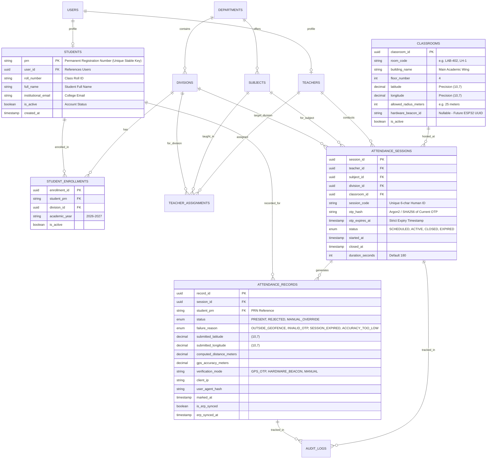
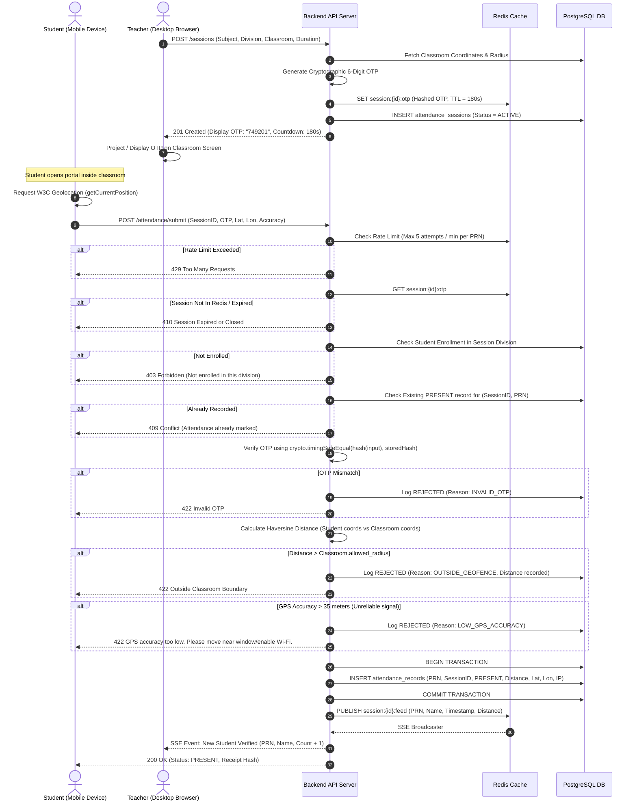
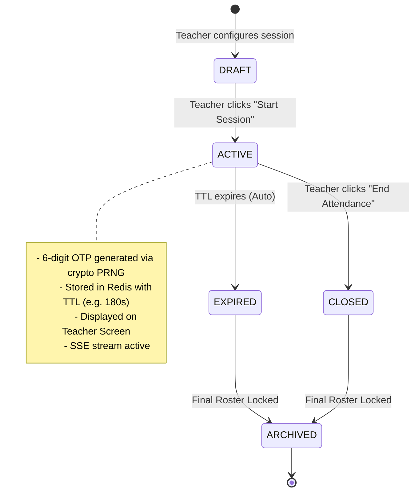
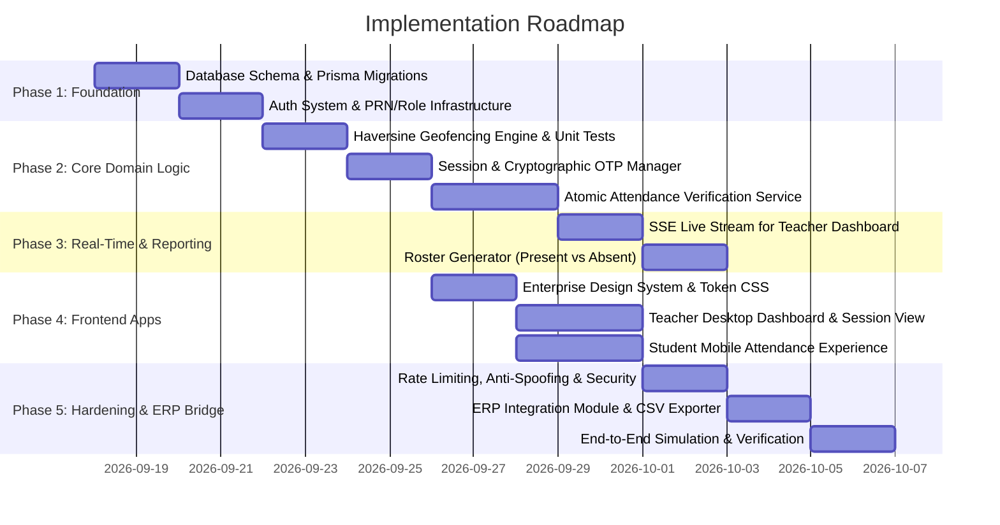
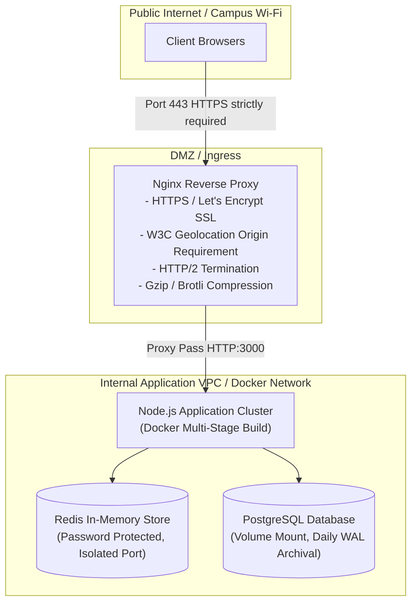

# GPS + OTP Student Attendance Management System
## Enterprise System Architecture & Technical Implementation Plan

---

## Executive Summary

The **GPS + OTP Student Attendance Management System** is an enterprise-grade, dual-factor physical presence verification platform designed for higher education institutions. The system guarantees that student attendance is authenticated authoritatively by combining **geospatial presence** (student device within a strictly configured classroom radius) with a **time-synchronized cryptographic One-Time Password (OTP)** displayed live by the course instructor.

Student identity is anchored strictly to their institutional **Permanent Registration Number (PRN)**, ensuring seamless integration with existing and future College Enterprise Resource Planning (ERP) systems. The architecture is engineered to be modular, allowing future expansion into hardware-assisted verification (ESP32 BLE beacons/Wi-Fi anchors) without disrupting the core data models or API contracts.

---

## 1. System Architecture

```mermaid
graph TB
    subgraph Clients["Client Layer (HTTPS / WSS)"]
        TC["Teacher Dashboard<br/>(Desktop-First SPA / PWA)"]
        SC["Student Mobile Portal<br/>(Mobile-First Responsive PWA)"]
        HC["Future Hardware Client<br/>(ESP32 BLE Beacon / Gateway)"]
    end

    subgraph Network["Network & Ingress Layer"]
        RP["Reverse Proxy & Load Balancer<br/>(Nginx / Caddy + TLS 1.3 Termination)"]
        WAF["Rate Limiter & WAF Rules"]
    end

    subgraph AppServer["Application Layer (Node.js / Express / Fastify + TypeScript)"]
        AuthM["Auth & RBAC Middleware<br/>(JWT + PRN Validation)"]
        GeoService["Geospatial Verification Engine<br/>(Haversine + Accuracy Filter)"]
        OtpService["OTP & Session State Manager<br/>(Crypto PRNG + Expiry Timer)"]
        AttendanceEngine["Atomic Attendance Processor<br/>(Transaction Controller)"]
        SSEHub["Real-time Event Hub<br/>(Server-Sent Events / WebSocket)"]
        AuditService["Tamper-Proof Audit Logger"]
        ErpAdapter["ERP Sync & Export Adapter"]
    end

    subgraph DataLayer["Persistence & Caching Layer"]
        Redis[("Redis 7 In-Memory Cache<br/>- Active Sessions<br/>- Hashed OTPs<br/>- Sliding-Window Rate Limits<br/>- Pub/Sub for SSE")]
        PostgreSQL[("PostgreSQL 16 Relational DB<br/>- Students (PRN Primary Index)<br/>- Classrooms & Polygons<br/>- Sessions & Attendance<br/>- Audit Trails & Roster Mappings")]
    end

    subgraph External["Institutional Boundary"]
        CollegeERP[("College ERP System<br/>(SIS / Academic Records / REST / SQL)")]
    end

    TC -->|HTTPS / REST + SSE| RP
    SC -->|HTTPS / REST (coords + OTP)| RP
    HC -.->|MQTT / HTTPS HMAC| RP

    RP --> WAF --> AuthM

    AuthM --> GeoService
    AuthM --> OtpService
    AuthM --> AttendanceEngine
    AttendanceEngine --> SSEHub
    AttendanceEngine --> AuditService

    GeoService --> PostgreSQL
    OtpService --> Redis
    AttendanceEngine --> PostgreSQL
    AttendanceEngine --> Redis
    SSEHub --> TC
    ErpAdapter --> CollegeERP
```

### Architectural Principles
1. **Authoritative Backend Validation**: The client device is completely untrusted. The client only supplies raw sensor inputs (`latitude`, `longitude`, `accuracy`, `timestamp`) and user input (`OTP`, `PRN`). All mathematical geofencing, temporal validation, and cryptographic checks execute strictly within the backend application layer.
2. **Stateless Scalability with Fast State Caching**: Session tokens and dynamic OTPs are cached in Redis with strict Time-to-Live (TTL), while long-term transactions, relations, and audit records reside in PostgreSQL.
3. **Decoupled Verification Pipeline**: The verification engine executes as an atomic pipeline of pluggable strategies (`LocationStrategy`, `OtpStrategy`, `HardwareBeaconStrategy`), enabling ESP32 support by simply appending a strategy without rewriting core domain services.

---

## 2. Technology Stack Recommendation & Rationale

| Layer | Recommended Technology | Technical Justification |
| :--- | :--- | :--- |
| **Frontend Framework** | **React (Vite) + TypeScript** | High rendering performance, strict type sharing with backend DTOs, extensive ecosystem for mobile PWA optimization, seamless handling of browser Geolocation API and real-time streams. |
| **Styling & UI Tokens** | **Modern Vanilla CSS Design Tokens** | Maximum runtime performance, zero CSS-in-JS overhead, robust theme variables (clean enterprise dark/light palette), bespoke typography control, eliminating framework bloat. |
| **Backend Runtime** | **Node.js (LTS) with TypeScript & Fastify / Express** | High asynchronous I/O concurrency. During attendance windows, 60–120 students submit coordinates and OTP within a 60-second burst. Node's non-blocking event loop paired with Redis handles these concurrent bursts with sub-10ms response times. |
| **Database** | **PostgreSQL 16** | Industry standard ACID compliance, strict relational constraints, native geometric indexing (`point`, `earthdistance` or PostGIS), partial unique indexes to guarantee zero duplicate attendance records, JSONB for flexible device telemetry and ERP payloads. |
| **Caching & In-Memory Store** | **Redis 7** | Sub-millisecond read/write for active session lookups, atomic sliding-window rate limiting (`INCR` + `EXPIRE`), native TTL for OTP expiration, and lightweight Pub/Sub for teacher dashboard SSE notifications. |
| **ORM / Query Builder** | **Prisma ORM** | Type-safe database queries, automated migration management, clean relational mapping, native schema modeling with PostgreSQL enums and indexes. |
| **Real-time Protocol** | **Server-Sent Events (SSE)** | Unidirectional real-time stream from server to teacher dashboard. SSE is lighter than WebSockets, operates over standard HTTP/2, automatically reconnects, and passes cleanly through campus proxies and corporate firewalls. |
| **Testing Suite** | **Vitest + Supertest + Testcontainers** | Fast unit tests for Haversine math and OTP algorithms; real containerized PostgreSQL/Redis integration tests. |

---

## 3. Project Directory Structure

A clean, modular monorepo architecture separating concerns between client, server, and shared contracts:

```text
AttendanceSystem_GPS/
├── .env.example
├── README.md
├── docker-compose.yml
├── package.json
├── packages/
│   └── shared/                      # Shared DTOs, Enums, Verification Types
│       ├── src/
│       │   ├── dtos/
│       │   │   ├── auth.dto.ts
│       │   │   ├── session.dto.ts
│       │   │   └── attendance.dto.ts
│       │   ├── types/
│       │   │   ├── geo.ts
│       │   │   └── user.ts
│       │   └── index.ts
│       └── tsconfig.json
├── server/                          # Backend API & Business Logic
│   ├── prisma/
│   │   ├── schema.prisma            # Normalized Relational Data Model
│   │   └── migrations/
│   ├── src/
│   │   ├── config/                  # Environment & App Configuration
│   │   ├── modules/
│   │   │   ├── auth/                # PRN & Password Auth, JWT issuance
│   │   │   ├── classrooms/          # Classroom CRUD, GPS radius coordinates
│   │   │   ├── academic/            # Subjects, Divisions, Batches, Student Enrollments
│   │   │   ├── sessions/            # Attendance Session Lifecycle, OTP Generation
│   │   │   ├── attendance/          # Geofence Validation, OTP Verification Engine
│   │   │   │   ├── strategies/      # GeolocationStrategy, OtpStrategy, Esp32Strategy
│   │   │   │   └── attendance.service.ts
│   │   │   ├── roster/              # Full Class Roster (Present / Absent) Engine
│   │   │   ├── erp-sync/            # ERP Export, Staging Tables, Sync Webhooks
│   │   │   └── audit/               # Immutable Security & Action Audit Logs
│   │   ├── middleware/              # RBAC, Rate Limiter, Error Handler, Security Headers
│   │   ├── utils/
│   │   │   ├── haversine.ts         # High-precision Geodesic Distance Math
│   │   │   ├── crypto.ts            # Secure PRNG OTP, Constant-Time Comparison
│   │   │   └── logger.ts            # Structured JSON Logging
│   │   ├── app.ts                   # Express/Fastify Application Setup
│   │   └── server.ts                # Server Entrypoint
│   ├── tests/
│   │   ├── unit/                    # Haversine, OTP, and Crypto Unit Tests
│   │   └── integration/             # End-to-end Attendance Verification Flow
│   └── tsconfig.json
└── client/                          # Frontend Application (React + Vite)
    ├── index.html
    ├── public/
    │   └── favicon.svg
    ├── src/
    │   ├── assets/
    │   ├── components/              # Enterprise UI Components (Modals, Tables, Badges)
    │   │   ├── common/
    │   │   ├── layout/
    │   │   └── forms/
    │   ├── context/                 # Auth & Session React Contexts
    │   ├── hooks/
    │   │   ├── useGeolocation.ts    # Robust W3C Geolocation Hook with Accuracy Bounds
    │   │   ├── useSessionSSE.ts     # Real-time Server-Sent Events Listener
    │   │   └── useCountdown.ts      # Active Session Timer
    │   ├── pages/
    │   │   ├── auth/                # Login (PRN for Students, Staff ID for Teachers)
    │   │   ├── teacher/             # Desktop Dashboard, Session Creator, Live Punch Feed
    │   │   ├── student/             # Mobile Attendance Punching Screen
    │   │   └── admin/               # Classroom & Academic Management
    │   ├── styles/                  # Clean Enterprise Design System Tokens & Base CSS
    │   │   ├── tokens.css           # Colors, typography, shadows, radii
    │   │   └── main.css             # Resets, layouts, utility primitives
    │   ├── utils/
    │   ├── App.tsx
    │   └── main.tsx
    ├── vite.config.ts
    └── tsconfig.json
```

---

## 4. Database ER Design (Normalized Relational Schema)

### Entity Relationship Diagram



### Key Relational Integrity Constraints
1. **Student Uniqueness in Session**: 
   `CREATE UNIQUE INDEX idx_unique_student_session ON attendance_records (session_id, student_prn) WHERE status = 'PRESENT';`
   *Guarantees at database level that a student can never have more than one valid presence recorded per session.*
2. **Deterministic Roster Generation (Present vs Absent)**:
   ```sql
   -- Query to generate 100% complete roster for ERP export
   SELECT 
       se.student_prn,
       s.roll_number,
       s.full_name,
       sess.session_id,
       sub.subject_code,
       COALESCE(ar.status, 'ABSENT') AS attendance_status,
       ar.marked_at,
       ar.computed_distance_meters
   FROM student_enrollments se
   JOIN students s ON se.student_prn = s.prn
   CROSS JOIN attendance_sessions sess
   JOIN subjects sub ON sess.subject_id = sub.subject_id
   LEFT JOIN attendance_records ar 
       ON ar.session_id = sess.session_id 
       AND ar.student_prn = se.student_prn 
       AND ar.status = 'PRESENT'
   WHERE sess.session_id = :target_session_id
     AND se.division_id = sess.division_id
   ORDER BY s.roll_number ASC;
   ```

---

## 5. API Architecture

All endpoints follow RESTful conventions, returning standard JSON schemas and RFC 7807 problem details for errors.

### Endpoints Specification

#### 1. Authentication & Identity
* `POST /api/v1/auth/login` — Login for Student (PRN + Password) or Teacher/Admin (Email + Password). Sets secure HttpOnly JWT.
* `POST /api/v1/auth/refresh` — Rotate short-lived access token via secure refresh token.
* `GET /api/v1/auth/me` — Return authenticated identity, role, and permissions.
* `POST /api/v1/auth/logout` — Invalidate session and revoke refresh token in Redis.

#### 2. Classrooms (Admin / Teacher)
* `GET /api/v1/classrooms` — List all active classrooms with geofence parameters.
* `POST /api/v1/classrooms` — Create classroom (Room code, building, latitude, longitude, radius).
* `PUT /api/v1/classrooms/:id` — Update classroom coordinates or geofence radius.

#### 3. Academic Entities
* `GET /api/v1/academic/subjects` — List subjects assigned to teacher.
* `GET /api/v1/academic/divisions` — List active divisions and batches.
* `GET /api/v1/academic/divisions/:id/roster` — List enrolled students with PRN.

#### 4. Attendance Session Management (Teacher)
* `POST /api/v1/sessions` — Create and start new attendance session.
  * Request: `{ subject_id, division_id, classroom_id, duration_seconds }`
  * Response: `{ session_id, session_code, otp, expires_at, classroom: { room_code, radius } }`
* `GET /api/v1/sessions/:id/live` — **Server-Sent Events (SSE)** endpoint. Streams live attendance punches, current count, remaining seconds.
* `POST /api/v1/sessions/:id/close` — Manually terminate/finalize an active session immediately.
* `POST /api/v1/sessions/:id/rotate-otp` — Optional teacher manual refresh of the current OTP.

#### 5. Attendance Verification (Student)
* `GET /api/v1/attendance/active-session` — Returns active session for the authenticated student's division (without revealing the OTP or coordinates).
* `POST /api/v1/attendance/submit` — Submit attendance verification payload.
  * Request Body:
    ```json
    {
      "session_id": "8f3b2d10-47b1-4f1a-b31c-99f2b84a9e22",
      "otp": "492817",
      "latitude": 18.5204303,
      "longitude": 73.8567437,
      "accuracy": 12.4,
      "timestamp": 1789642800000
    }
    ```
  * Success Response (200 OK):
    ```json
    {
      "status": "PRESENT",
      "message": "Attendance recorded successfully.",
      "prn": "PRN20241001",
      "marked_at": "2026-09-17T16:45:10.120Z",
      "distance_meters": 8.2,
      "receipt_hash": "e3b0c44298fc1c149afbf4c8996fb92427ae41e4649b934ca495991b7852b855"
    }
    ```
  * Rejection Response (422 Unprocessable Content):
    ```json
    {
      "status": "REJECTED",
      "code": "GEOFENCE_VIOLATION",
      "message": "You are outside the classroom boundary. Required radius: 25m, Detected distance: 84m."
    }
    ```

#### 6. Roster, Reporting & ERP Export
* `GET /api/v1/reports/sessions/:id/roster` — Full class roster breakdown (Present, Absent, Rejected).
* `POST /api/v1/erp/sync/session/:id` — Trigger immediate synchronization to college ERP endpoint or staging table.

---

## 6. Authentication & RBAC Architecture

1. **Credentials & Password Storage**:
   * All passwords hashed using **Argon2id** (m=65536, t=3, p=4) or **bcrypt** (salt rounds = 12).
   * Student accounts can be pre-provisioned via college ERP bulk import, initial password set to secure format with mandatory first-login password reset.
2. **Tokens**:
   * **Access Token**: Short-lived (15 minutes), signed with asymmetric RS256 or high-entropy HS256 secret. Contains `{ user_id, prn, role, division_id }`.
   * **Refresh Token**: Long-lived (7 days), stored inside an `HttpOnly`, `SameSite=Strict`, `Secure` cookie. Stored in Redis with device identifier hash for instant revocation.
3. **Role-Based Access Control**:
   * `STUDENT`: Permitted only to view own enrollments, fetch active session metadata for their enrolled division, submit their own attendance punch, and view personal attendance history.
   * `TEACHER`: Permitted to initiate sessions for assigned subjects/divisions, view live student punch feed, close sessions, edit manual overrides with audit trail.
   * `ADMIN`: Full management of classrooms, physical coordinates, academic curricula, faculty allocations, and ERP sync triggers.

---

## 7. Attendance Verification Sequence

The verification sequence implements an atomic, zero-trust validation pipeline on the backend.



---

## 8. Security Architecture & Threat Modeling

A robust physical presence system must explicitly defend against realistic evasion and tampering vectors.

### Threat Matrix & Defenses

| Threat Vector | Real-World Attack Scenario | Technical Mitigation Implemented |
| :--- | :--- | :--- |
| **Proxy Attendance / OTP Sharing** | Student inside classroom messages OTP via WhatsApp/Telegram to an absent friend at home. | **Defeated by Dual-Factor Requirement**: The friend at home has the correct OTP, but their GPS coordinates are miles away. Geofence calculation strictly rejects the submission with `OUTSIDE_GEOFENCE`. |
| **Software GPS Spoofing (Mock Location)** | Absent student uses Android Developer "Mock Location" app or browser coordinate override. | 1. **Accuracy and Metadata Inspection**: Spoofed coordinates often report `accuracy = 0.0` or exact integer values, or lack altitude/speed changes.<br/>2. **Client-side Detection**: Check `navigator.webdriver`, mock location provider flags where exposed.<br/>3. **IP Subnet Corroboration**: Log client IP and correlate against campus Wi-Fi CIDR blocks. Out-of-subnet cellular IPs with border coordinates are flagged for audit.<br/>4. **Future Hardware Anchor**: ESP32 BLE signal cannot be spoofed over software mock locations. |
| **OTP Brute-Forcing** | Attacker scripts automated requests cycling through 000000–999999. | **Strict Redis Sliding Window Rate Limiting**: Max 5 incorrect OTP attempts per student PRN per session. Account locks for 5 minutes after 5 failures. |
| **Replay Attacks** | Attacker intercepts a valid previous attendance submission and replays it. | 1. **Idempotency & Timestamp Checks**: Request timestamp must be within ±60 seconds of server time.<br/>2. **Database Unique Constraint**: Unique index `(session_id, student_prn)` renders replayed requests harmless. |
| **Timing Attacks on OTP** | Microsecond differences in string comparison reveal character-by-character OTP validity. | Backend uses Node.js `crypto.timingSafeEqual` over fixed-length SHA-256 digests. |
| **Tampering with Audit Logs** | Rogue actor or compromised account attempts to modify past attendance records. | Write-once `audit_logs` table. Attendance records have immutable timestamps and trigger audit rows upon any manual teacher override with mandatory reason fields. |

---

## 9. GPS & Geofencing Design

### Mathematical Derivation: The Haversine Formula

To calculate the great-circle distance between the student's device and the classroom center across the Earth's surface:

$$\Delta \phi = \phi_2 - \phi_1 \quad (\text{difference in latitude in radians})$$
$$\Delta \lambda = \lambda_2 - \lambda_1 \quad (\text{difference in longitude in radians})$$
$$a = \sin^2\left(\frac{\Delta \phi}{2}\right) + \cos(\phi_1) \cdot \cos(\phi_2) \cdot \sin^2\left(\frac{\Delta \lambda}{2}\right)$$
$$c = 2 \cdot \text{atan2}\left(\sqrt{a}, \sqrt{1-a}\right)$$
$$d = R \cdot c$$

Where:
* $R = 6,371,000\text{ m}$ (mean Earth radius in meters)
* $\phi_1, \lambda_1$ = Classroom latitude & longitude in radians
* $\phi_2, \lambda_2$ = Student device latitude & longitude in radians
* $d$ = Exact geodesic surface distance in meters

### Implementation Strategy
```typescript
export function calculateHaversineDistanceMeters(
  lat1: number, lon1: number,
  lat2: number, lon2: number
): number {
  const R = 6371000; // Earth radius in meters
  const toRad = (deg: number) => (deg * Math.PI) / 180;

  const dLat = toRad(lat2 - lat1);
  const dLon = toRad(lon2 - lon1);
  const phi1 = toRad(lat1);
  const phi2 = toRad(lat2);

  const a =
    Math.sin(dLat / 2) * Math.sin(dLat / 2) +
    Math.cos(phi1) * Math.cos(phi2) * Math.sin(dLon / 2) * Math.sin(dLon / 2);

  const c = 2 * Math.atan2(Math.sqrt(a), Math.sqrt(1 - a));
  return Math.round((R * c) * 100) / 100; // Round to 2 decimal places
}
```

### Accuracy Bounds & Multi-Story Attenuation
* **Accuracy Threshold**: The W3C Geolocation API provides a `coords.accuracy` attribute (in meters, representing a 95% confidence radius). If `coords.accuracy > 30` meters, the measurement is rejected because the error margin exceeds typical classroom dimensions.
* **Campus Building Tolerance Buffer**: While standard classroom radius is typically 20–25 meters, concrete walls and multi-floor buildings cause slight GPS drift. The system allows an administrator-configurable tolerance buffer (default: +5m) per classroom to eliminate false rejections on edge seats.

---

## 10. OTP & Session Lifecycle Design

### Session State Machine



### Dynamic Features
1. **Cryptographic Generation**: Built with Node.js `crypto.randomInt(100000, 1000000)`, guaranteeing non-predictable 6-digit integers.
2. **Optional Rolling/Rotating OTP**: For high-stakes examinations or large lecture halls, the teacher can toggle **Rotating OTP Mode**, generating a fresh 6-digit OTP every 45 seconds. The backend keeps a 15-second grace window for the immediately preceding OTP to account for network transmission latency.

---

## 11. Future ESP32 / Hardware Integration Design

The system is architected so that low-cost ESP32 microcontrollers can be installed in classrooms in Phase 6 as a **third hardware verification anchor** without altering database schemas or API contracts.

```mermaid
graph LR
    subgraph Classroom
        ESP["ESP32 Microcontroller<br/>(Classroom Ceiling / Podium)"]
        TeacherScreen["Teacher Projector"]
        StudentPhone["Student Mobile Phone"]
    end

    subgraph CloudServer["Attendance Cloud API"]
        HWAdapter["Hardware Verification Strategy<br/>(Interface: IVerificationStrategy)"]
        CoreAPI["Core Verification Engine"]
    end

    ESP -->|1. BLE Rotating Ephemeral UUID| StudentPhone
    TeacherScreen -->|2. Visual Dynamic OTP| StudentPhone
    StudentPhone -->|3. GPS Coordinates| CloudServer
    StudentPhone -->|4. Post (GPS + OTP + BLE UUID)| CloudServer
    ESP -.->|Heartbeat / Sync via MQTT| HWAdapter
    HWAdapter --> CoreAPI
```

### Architectural Compatibility
* The `Classrooms` table already includes `hardware_beacon_id` and `hardware_secret_hash`.
* The `AttendanceRecords` table stores `verification_mode` (`GPS_OTP`, `ESP32_BLE_GPS_OTP`).
* In the software backend, the `AttendanceService` relies on a Strategy Pattern:
  ```typescript
  export interface IVerificationStrategy {
    name: string;
    verify(context: AttendanceContext): Promise<VerificationResult>;
  }
  ```
  When the ESP32 is deployed, `Esp32BleStrategy` is simply registered into the verification pipeline.

---

## 12. College ERP Integration Strategy

College ERP systems (such as SAP Campus Management, Ellucian Banner, or custom institutional SQL databases) require dependable, idempotent data synchronization keyed to students' PRN.

```mermaid
graph TD
    subgraph AttendanceSystem["GPS Attendance Platform"]
        AR[("attendance_records")]
        SE[("student_enrollments")]
        SyncEngine["ERP Sync Worker<br/>(Queue with Exponential Backoff)"]
        StagingTable[("erp_export_staging")]
    end

    subgraph CollegeERP["College Institutional ERP"]
        ERP_API["ERP Ingestion REST Endpoint"]
        ERP_DB[("ERP Attendance Database")]
    end

    AR --> SyncEngine
    SE --> SyncEngine
    SyncEngine -->|Generate Complete Roster<br/>(Present & Absent)| StagingTable
    StagingTable -->|Idempotent POST with HMAC Signature| ERP_API
    ERP_API --> ERP_DB
    ERP_API -->> StagingTable: Acknowledge Batch ID & Status
```

### Key Integration Mechanics
1. **PRN as Primary Identity Anchor**: The student's PRN never changes throughout their academic tenure, ensuring 100% collision-free joining with ERP records.
2. **Deterministic Complete Roster**: The system does not merely send "who was present." It generates a complete reconciliation roster:
   $$\text{Absent Roster} = \text{Enrolled Students in Division} \setminus \text{Present Students}$$
3. **Idempotency & Staging**: Every export batch generates an `erp_sync_batch_id`. If network communication fails, the job retries safely without creating duplicate attendance entries in the ERP.
4. **Export Modalities**:
   * **Webhook / REST Sync**: Automated real-time push to ERP API on session close.
   * **Direct Database Staging**: Writes to a shared read-only ERP staging view.
   * **Standard CSV / Excel Export**: One-click standardized export for institutions without API access.

---

## 13. UI/UX Design System (Enterprise Minimalist SaaS)

The interface follows the visual hierarchy and restraint of top-tier enterprise platforms (Linear, Stripe Dashboard, AWS Console).

### Design Tokens
* **Color Palette**:
  * **Backgrounds**: Canvas `#090d16` (Dark) / `#f8fafc` (Light); Surface `#111827` (Dark) / `#ffffff` (Light).
  * **Borders & Dividers**: Subdued slate `#1e293b` (Dark) / `#e2e8f0` (Light).
  * **Typography**: Primary `#f1f5f9` (Dark) / `#0f172a` (Light); Muted `#94a3b8` (Dark) / `#64748b` (Light).
  * **Accent & Brand**: Institutional Navy/Indigo `#4f46e5`, Sky Blue `#0284c7`.
  * **Status Colors**: Success (Present) `#059669`; Error (Rejected) `#e11d48`; Warning `#d97706`.
* **Typography**: Clean humanist sans-serif (`Inter`, `system-ui`, `-apple-system`). Monospaced digits (`font-variant-numeric: tabular-nums`) for OTP, countdown timers, and coordinates.
* **Layout Structure**:
  * **Teacher Dashboard**: Desktop-first layout with high information density. Left sidebar navigation, central active session control card with giant readable OTP, right live-stream attendance counter, and bottom searchable data table.
  * **Student Portal**: Mobile-first focused wizard. Step 1: Location Access Check; Step 2: Classroom Proximity Indicator; Step 3: Numeric OTP Pad; Step 4: Digital Attendance Receipt with PRN watermark.

---

## 14. Development Phases & Milestones



---

## 15. Testing Strategy

| Test Layer | Tools | Scope & Scenarios Covered |
| :--- | :--- | :--- |
| **Unit Tests** | Vitest | - Haversine distance calculations across equator, poles, and campus coordinates.<br/>- OTP generation, hashing, and timing-safe comparison.<br/>- PRN string normalization and regex validation. |
| **Integration Tests** | Supertest + Testcontainers (Postgres + Redis) | - Complete student attendance submission lifecycle.<br/>- Rejection on expired session.<br/>- Rejection on distance > radius.<br/>- Rejection on invalid OTP.<br/>- Rejection on non-enrolled division.<br/>- Database unique constraint enforcement (duplicate punch prevention). |
| **Geospatial Boundary Tests** | Custom Coordinate Simulation Suite | - Simulation of student at 0m (center), 10m (inside), 24.9m (boundary), and 25.1m (outside).<br/>- Ingestion of various GPS accuracy figures (5m, 15m, 45m). |
| **Load & Concurrency Tests** | k6 / Artillery | - Burst simulation: 120 students submitting valid coordinates and OTP within a 15-second window to verify zero database deadlocks and sub-50ms latency. |

---

## 16. Deployment & Network Architecture



> [!IMPORTANT]
> **Strict HTTPS Requirement**: The modern W3C Geolocation API (`navigator.geolocation`) is **categorically disabled by all major web browsers (Google Chrome, Apple Safari, Mozilla Firefox)** on insecure origins. The system must operate under full HTTPS with valid TLS certificates in staging and production (localhost is the only browser-permitted HTTP exception).

---

## 17. Potential Failure Cases & Robust Handling

| Failure Scenario | Root Cause | System Defense & Recovery Mechanism |
| :--- | :--- | :--- |
| **Indoor GPS Signal Attenuation** | Concrete ceilings, metal rebar, or underground lecture halls degrade GPS reception. | 1. Frontend explicitly guides the student: *"Ensure Wi-Fi is enabled to enhance indoor location accuracy via Wi-Fi triangulation."*<br/>2. Classroom configuration allows setting tailored radius per room (e.g. 35m for basement labs vs 20m for outdoor pavilions).<br/>3. Teacher retains authenticated **Manual Override** capability with mandatory audit reason logging. |
| **Mobile Clock Drift** | Student's phone clock is fast/slow by several minutes, causing false session expiration on client. | Client never evaluates session expiration locally. Expiration countdown is computed against the server's synchronized NTP clock. |
| **Network Dropout During Submission** | Cell carrier connection drops precisely when student taps "Submit Attendance". | 1. Client generates a deterministic client-side Idempotency Key (`session_id + prn`).<br/>2. On network recovery, auto-retry sends the same idempotency key, preventing double-marking or erroneous rejection. |
| **Teacher Prematurely Closes Session** | Teacher clicks "Close" while students are still in line or typing OTP. | 1. Backend transitions session to `CLOSED`.<br/>2. In-flight requests received before the close timestamp are processed within a 5-second graceful drain window.<br/>3. Dashboard clearly displays exact cutoff timestamp. |
| **Duplicate Concurrent Punches** | Student double-taps button or runs multiple tabs with same PRN. | Handled via PostgreSQL row-level locking during validation and backed by the atomic database unique constraint `UNIQUE (session_id, student_prn)`. The second request returns a clean `409 Conflict` ("Attendance already recorded"). |

---

## User Review Required

> [!IMPORTANT]
> **Implementation Approval**:
> Please review this complete 17-part architecture specification. Upon your confirmation and approval, we will proceed to execute the implementation starting with **Phase 1: Foundation (Database Schema, Prisma Migrations, and Core Domain Models)**.
